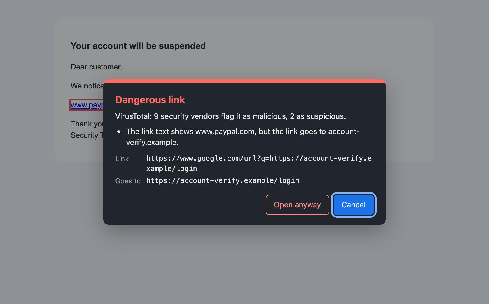
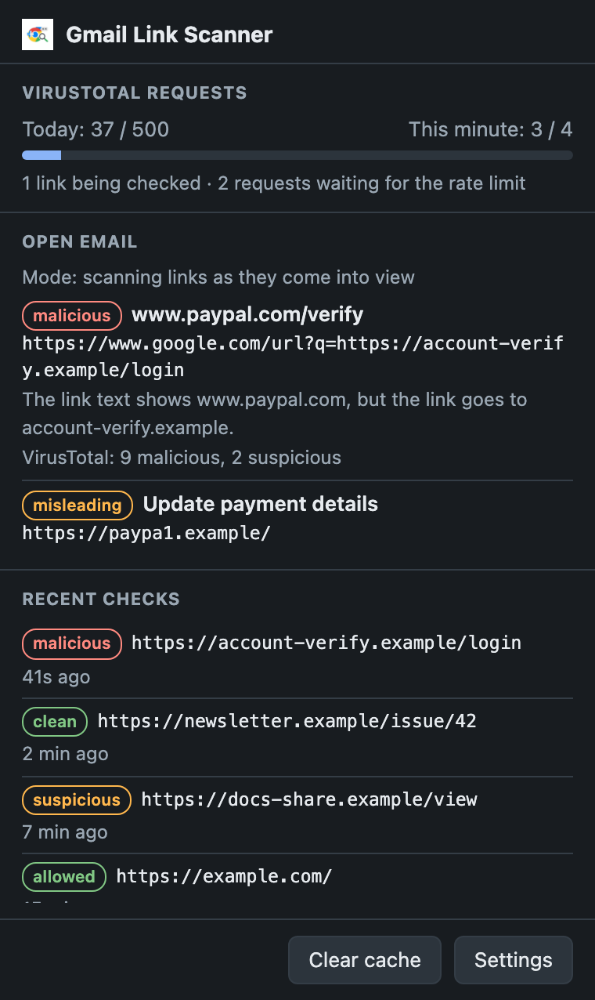

# Gmail Link Scanner (VirusTotal)

A Chromium extension (Manifest V3, works in Chrome and Microsoft Edge) that checks the links inside your Gmail messages against [VirusTotal](https://www.virustotal.com/) and local phishing heuristics, and warns you before you open anything dangerous.

## Screenshots



*The warning panel shown when you click a flagged link (demo email with made-up `.example` domains).*

| Toolbar popup | Settings |
|---|---|
|  |  |

*Popup and settings, with demo data. Both follow the system light/dark theme.*

## Description

Phishing and malware links are often hidden behind innocuous-looking anchor text in emails. This extension checks every link inside the emails you open, using VirusTotal's multi-engine URL analysis plus a few local checks for common phishing tricks, and outlines anything suspicious. Clicking a link that is flagged, or not yet checked, opens a warning panel before anything is loaded.

## Features

- **Only links in emails** — links inside email message bodies are scanned and intercepted. Gmail's own interface (navigation, menus, help links) is never scanned and works as normal.
- **Three scan modes** (Settings → Scanning):
  - *As they come into view* (default) — links are scanned when they scroll near the screen, so long threads don't use up the quota on links you never see.
  - *Every link at once, in parallel* — all links in an opened email are scanned immediately. Fastest with a key that allows many requests per minute.
  - *Only when clicked* — no background scanning at all; uses the least quota.
- **Quota-friendly VirusTotal lookups** — the existing VirusTotal report for a URL is fetched first (one request). A new scan is only submitted when VirusTotal has never seen the URL or its clean report is older than 7 days. Reports that already flag a URL are used at any age.
- **One shared rate limiter** — every VirusTotal request goes through a single queue that respects the per-minute and per-day limits (default 4/min and 500/day, the free tier; adjustable for premium keys). Clicks jump ahead of background scans, and an unexpected `429` pauses the queue for a minute.
- **Redirect unwrapping with no blind spot** — Google's click-tracking wrapper (`google.com/url?q=...`) and other query-parameter redirectors are unwrapped. Every address in the chain is checked (except Google's own wrapper), and the worst verdict wins, so a malicious host can't pass as clean by putting a harmless URL in its `?u=` parameter.
- **Shows where a link ends up** — when VirusTotal knows a link's final destination (for example behind a URL shortener), the tooltip and warning panel show it.
- **Local phishing checks** (no network needed):
  - link text that shows one domain but links to another (`www.paypal.com` → `account-verify.example`);
  - look-alike international characters (Cyrillic `а` in `pаypal.com`) — accented Latin domains like `räksmörgås.se` are fine;
  - typosquats of well-known domains and of your allowed domains (`paypa1.com`, `rnicrosoft.com`, `handelsbankem.se`);
  - a real domain used as a subdomain (`paypal.com.secure-check.example`).
- **Warning panel** — red (malicious), amber (suspicious) or amber-dashed (misleading) outlines, and an in-page panel instead of a browser `confirm()` dialog: it shows the VirusTotal counts, the reasons, the real destination, and *Cancel* / *Open anyway*. Keyboard: Escape cancels. Because *Open* is a real click, browsers don't block the new tab as a popup even after a slow check.
- **Click interception with no unchecked gap** — left clicks, Ctrl/Cmd/Shift-clicks, Enter and middle-clicks on any link not verified clean are held until the check completes. A verdict only applies to the exact address that was checked; if a link's `href` changes, it's checked again. Verdicts are stored privately, so an email can't fake a "clean" mark.
- **Fail closed** — no API key, network errors, rate limits, timeouts, too many redirects: the link is never treated as clean; the panel says why and lets you decide.
- **Toolbar popup and badge** — the badge shows how many flagged links the open email has. The popup lists them, shows today's request budget and queue, recent checks, and has a *Clear cache* button. It warns if an email is open but its message body can't be found (which would mean Gmail changed its layout and links aren't being checked).
- **Settings** — *Test key* button, scan mode, request limits, and allow/deny lists with validation and JSON export/import.
- **Caching and de-duplication** — verdicts are cached for 24 hours (errors for 5 minutes) in `chrome.storage.local`; tracking parameters (`utm_*`, `fbclid`, `mc_eid`…) and `#fragments` are stripped first, so the same link from different newsletters is looked up once, and recipient identifiers aren't sent to VirusTotal. Concurrent checks of the same URL share one lookup.

## How it works

1. **`contentScript.js`** (runs on `mail.google.com`, together with `heuristics.js`)
   - Finds external `http(s)` links inside message bodies (`.a3s`), registers them according to the scan mode (an `IntersectionObserver` for "as they come into view"), and asks the background worker to check them, at most 4 at a time (16 in "every link at once" mode).
   - Batches Gmail's DOM changes from a `MutationObserver`, and re-checks links whose `href` changes.
   - Keeps each verdict in a private `WeakMap` together with the exact `href` it was for, and decorates the link (`markLink`), including the local heuristics from `heuristics.js`.
   - Intercepts `click` and middle-button `auxclick` (capture phase) on links in message bodies, and shows the warning panel (a closed shadow DOM) while checking and for anything not clean. Opens links with `window.open(href, '_blank', 'noopener,noreferrer')`.
   - Reports the number of flagged links for the badge, and answers the popup's summary request.

2. **`background.js`** (Manifest V3 service worker)
   - Builds the redirect chain (up to 3 hops; deeper chains fail closed) and checks every host except the trusted `google.com/url` wrapper against the deny list, then the allow list.
   - For each remaining address: strips tracking parameters, checks the cache, de-dupes in-flight lookups, then asks VirusTotal: `GET /api/v3/urls/{id}` first; only if needed `POST /api/v3/urls` and a few polls of `GET /api/v3/analyses/{id}` with growing gaps.
   - Every request goes through the rate limiter (priority queue; state kept in `chrome.storage.session` and the daily count in `chrome.storage.local`, so a restarted service worker keeps counting), with a keep-alive while requests are queued.
   - Returns `{ ok, malicious, suspicious, maliciousCount, suspiciousCount, resolvedUrl, finalUrl?, flaggedUrl?, listed? }`, and keeps a short list of recent checks for the popup (session storage only, cleared when the browser closes).

3. **`popup.html` / `popup.js`** — the toolbar popup. **`options.html` / `options.js` / `domains.js`** — settings, saved to `chrome.storage.sync`.

## Installation

1. Get a free API key from [VirusTotal](https://www.virustotal.com/gui/join-us).
2. Clone or download this repository.
3. Open `chrome://extensions` in Chrome (or `edge://extensions` in Microsoft Edge).
4. Enable **Developer mode** (top-right toggle in Chrome, left sidebar in Edge).
5. Click **Load unpacked** and select the project folder.
6. Open the extension's options (**Details → Extension options**, or the toolbar popup → **Settings**), paste your API key, click **Test key**, choose a scan mode and click **Save**.
7. Open Gmail — links in the emails you open are checked automatically.

## Usage

- Open an email. Depending on the scan mode, links are checked as they come into view, all at once, or only when clicked.
- **Red** outline: flagged malicious by VirusTotal (or on your blocked list). **Amber**: suspicious. **Amber dashed**: VirusTotal has nothing against it, but it looks misleading. Hover for the reasons.
- Clicking a flagged or unchecked link opens the warning panel. Choose **Open anyway** or **Cancel** (Escape). Links already verified clean open normally.
- The toolbar badge counts the flagged links in the open email; click the icon for details and your remaining VirusTotal quota.

## Tests

No dependencies; needs Node 22+.

```sh
node --test tests/                    # background logic, heuristics, domain lists (Node)
node tests/run-content-tests.js       # content script in a headless Edge/Chrome
node tests/run-extension-smoke.js     # loads the real extension in a headless Edge/Chromium
```

The browser tests use a throwaway profile and never touch your own. The extension smoke test needs a browser that still accepts `--load-extension` (Edge or Chromium; recent Google Chrome builds don't). Nothing is sent to VirusTotal by any test.

## Permissions

| Permission | Why it's needed |
|---|---|
| `storage` | Settings (`chrome.storage.sync`), the result cache and daily request count (`chrome.storage.local`), and the rate-limit window and recent checks (`chrome.storage.session`). |
| `host_permissions: mail.google.com` | Run the content script and read links inside Gmail. |
| `host_permissions: www.virustotal.com` | Call the VirusTotal API. |

The toolbar popup (`action`) needs no permission. The content script is declared statically, and the popup talks to it with `tabs.sendMessage`, which doesn't require the `tabs` permission, so `tabs`, `scripting` and `activeTab` are intentionally not requested.

## Limitations & caveats

- **Rate limits**: on the free tier, VirusTotal answers 4 requests a minute and 500 a day. Known URLs cost one request; unknown URLs cost a submit and up to 4 polls. A busy inbox can still use up the daily budget — the popup shows where you stand, and links that can't be checked get a "could not be checked" warning, never a silent pass.
- **Parallel scanning is capped by your key**: "every link at once" sends everything immediately, but the rate limiter still lets only as many requests through per minute as your key allows.
- **Message body detection relies on Gmail's markup**: links are recognised as email content by Gmail's message body class (`.a3s`). If Gmail changes it, links stop being checked; the popup warns when an email is open but no message body is found.
- **Not every way of opening a link can be intercepted**: right-click → *Open link in new tab* and dragging a link onto the tab bar bypass page events, so those links open without a check.
- **Redirect unwrapping is heuristic**: only wrappers that carry the destination in a query parameter can be unwrapped locally. Path-based shorteners (`bit.ly/abc`) are scanned as they are; VirusTotal's report shows their final destination when it knows it. Wrapper URLs are scanned as well as their destinations, so a tracking link costs two lookups.
- **The heuristics are heuristics**: the domain checks use a small built-in list of public suffixes and well-known brands rather than the full Public Suffix List, and some legitimate newsletters show one domain while linking through another. They warn; you decide.
- **Client-side API key**: the key lives in the browser and is sent directly to VirusTotal. For team use, consider a server-side proxy.

## Privacy & security

- Links in the emails you open are sent to VirusTotal (with tracking parameters and fragments removed). Don't use this extension on mailboxes where link URLs are highly sensitive unless you're comfortable sharing them with VirusTotal. "Only when clicked" mode sends only the links you click.
- The API key is stored only in `chrome.storage.sync` and is used solely to authenticate requests to VirusTotal.
- No data is sent anywhere except VirusTotal. The heuristics run entirely locally.

## License

Licensed under the [MIT License](LICENSE).
