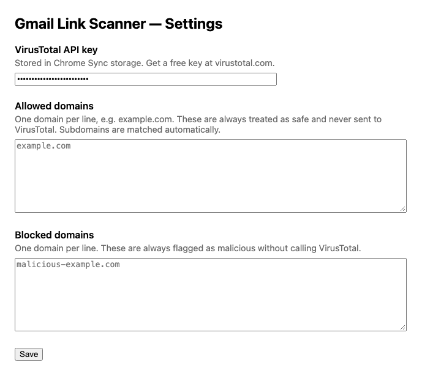

# Gmail Link Scanner (VirusTotal)

A Chrome extension (Manifest V3) that scans links inside Gmail messages against [VirusTotal](https://www.virustotal.com/) and warns you before you navigate to a flagged site.

## Screenshot

*The settings page. In Gmail itself, flagged links get a red (malicious) or amber (suspicious) outline.*

## Description

Phishing and malware links are often hidden behind innocuous-looking anchor text in emails. This extension inspects every link rendered inside Gmail, checks it against VirusTotal's multi-engine URL analysis, and visually flags anything suspicious. If you click a link that has been (or turns out to be) flagged as malicious, the extension blocks the navigation and asks you to confirm before proceeding.

## Features

- **Parallel scanning** — links in an open Gmail message are checked against VirusTotal concurrently (up to 4 at a time), instead of one at a time.
- **Redirect unwrapping** — Gmail/Google click-tracking wrapper links (`google.com/url?q=...`) and other common query-param redirectors are unwrapped to their real destination before scanning, so the actual target site gets checked, not the wrapper.
- **Malicious + suspicious flagging** — links get a red (malicious) or amber (suspicious) outline and an updated tooltip based on VirusTotal's per-engine verdicts, including the malicious/suspicious engine counts.
- **Allow/deny domain lists** — trust specific domains (skipped entirely, never sent to VirusTotal) or always block specific domains (flagged without an API call), configurable from the options page.
- **Click interception with no unchecked gap** — a click on any link that isn't already verified clean is intercepted and checked before navigating, including links still mid-scan in the background, so there's no timing window where a click slips through unchecked.
- **Fail-safe on errors** — if a check can't be completed (no API key, network error, rate limit, timeout), you get an explicit warning dialog instead of the link silently opening.
- **Local caching** — successful results are cached in `chrome.storage.local` for 24 hours; transient errors are negatively cached for 5 minutes to avoid hammering a failing/rate-limited API. Expired entries are pruned opportunistically so the cache doesn't grow unbounded.
- **In-flight request de-duplication** — concurrent checks for the same URL (e.g. two links pointing at the same site, or a click racing an auto-scan) share a single VirusTotal lookup instead of issuing duplicate requests.
- **Dynamic content support** — a `MutationObserver` watches Gmail's DOM so links in newly loaded threads/messages are scanned as they appear.
- **Bring your own API key** — your VirusTotal API key is stored via `chrome.storage.sync` and never leaves your browser except to talk to VirusTotal directly.

## How it works

The extension has three main parts:

1. **`contentScript.js`** (runs on `mail.google.com`)
   - Scans the DOM for `<a href>` elements pointing to `http(s)` URLs and checks them against the background service worker in parallel (bounded concurrency), decorating each link based on the result (`markLink`).
   - Intercepts click events (capture phase) on links: anything not already verified `clean` or allow-listed is blocked from navigating until a check resolves — this includes links still being auto-scanned, so a click can never race past an in-progress check.
   - De-dupes concurrent checks for the same URL locally (`pendingChecks`) and enforces a local 30s timeout as a fail-safe in case the background worker never responds.
   - Shows a `confirm()` dialog before navigating to anything malicious, suspicious, or unverifiable; opens links via `window.open(href, '_blank', 'noopener,noreferrer')` to avoid handing a potentially malicious destination a reference back to the Gmail tab.
   - Uses a `MutationObserver` on `document.body` to catch links that load asynchronously as you navigate between emails.

2. **`background.js`** (Manifest V3 service worker)
   - Receives `checkUrl` messages from the content script.
   - Unwraps common redirect-wrapper URLs (Gmail/Google's `url?q=...` and generic `url=`/`u=`/`redirect=`/etc. query params, up to 3 hops) to find the real destination before doing anything else.
   - Checks the resolved host against your allow/deny lists first — allowed domains skip VirusTotal entirely, denied domains are flagged immediately without an API call.
   - Otherwise looks up the resolved URL in a local cache (`chrome.storage.local`, 24h TTL for verdicts / 5min TTL for retryable errors) before making any network calls, and de-dupes concurrent in-flight requests for the same URL.
   - If not cached, submits the URL to VirusTotal's `POST /api/v3/urls` endpoint to trigger an analysis, then polls `GET /api/v3/analyses/{id}` (up to 10 attempts, 1.5s apart) until the scan completes.
   - If polling times out, it falls back to fetching the URL object directly (`GET /api/v3/urls/{id}`, using proper unpadded base64url encoding) and uses `last_analysis_stats`.
   - Returns a normalized result: `{ ok, malicious, suspicious, maliciousCount, suspiciousCount, resolvedUrl, listed? }`.
   - Opportunistically prunes expired cache entries on writes, and on install/startup, so `chrome.storage.local` doesn't grow unbounded.

3. **`options.html` / `options.js`**
   - A settings page for your VirusTotal API key, plus allow-list and deny-list domain textareas (one domain per line; subdomains match automatically).
   - Everything is saved to `chrome.storage.sync` so it follows you across signed-in Chrome instances.

## Installation

1. Get a free API key from [VirusTotal](https://www.virustotal.com/gui/join-us).
2. Clone or download this repository.
3. Open `chrome://extensions` in Chrome.
4. Enable **Developer mode** (top-right toggle).
5. Click **Load unpacked** and select the project folder.
6. Click **Details → Extension options** (or right-click the extension icon → **Options**) and paste your VirusTotal API key. Optionally add allow/deny domains, then click **Save**.
7. Open Gmail — links in your messages will start being scanned automatically.

## Usage

- Open any email in Gmail. Links are scanned in the background as the message renders.
- A link outlined in **red** has been flagged malicious by VirusTotal; **amber** means suspicious. Hover over it to see the verdict (and the resolved destination, if it was a redirect wrapper) in the tooltip.
- Clicking a flagged, unchecked, or unverifiable link shows a confirmation dialog; choose **OK** to open it anyway in a new tab, or **Cancel** to stay on the page.
- Links on domains in your allow list open immediately with no check or prompt. Links on domains in your deny list are always blocked with a warning, without calling VirusTotal.

## Permissions

| Permission | Why it's needed |
|---|---|
| `storage` | Store the VirusTotal API key and allow/deny lists (`chrome.storage.sync`) and cache scan results (`chrome.storage.local`). |
| `host_permissions: mail.google.com` | Run the content script and read links inside Gmail. |
| `host_permissions: virustotal.com` | Call the VirusTotal API to submit and retrieve URL analyses. |

The content script is declared statically in the manifest and the extension never needs to read tab URLs or inject scripts on demand, so `scripting`, `activeTab`, and `tabs` are intentionally not requested.

## Limitations & caveats

- **Rate limits**: VirusTotal's free API tier has strict rate limits (4 requests/minute, 500/day). Caching and request de-duplication help, but a message with many uncached links can still hit limits — those get a "could not verify" warning rather than a silent pass-through.
- **Client-side API key**: The API key lives in the browser and is sent directly to VirusTotal from the extension. For team/production use, consider routing requests through a server-side proxy to avoid exposing the key and to centralize rate-limit handling.
- **Polling delay**: New/unseen URLs may take a few seconds to analyze (up to `10 attempts × 1.5s`) before a verdict is available; navigation is blocked until that check resolves or times out (30s local fail-safe).
- **Redirect unwrapping is heuristic**: only wrapper styles that embed the destination URL in a query parameter (Google's `url?q=...`, and generic `url=`/`u=`/`redirect=`/etc.) can be unwrapped client-side. Path-based shorteners (e.g. `bit.ly/abc`) require following an HTTP redirect and aren't unwrapped.

## Privacy & security

- Every link you open in a scanned Gmail message is sent to VirusTotal for analysis. Do not use this extension on mailboxes where link URLs are highly sensitive, unless you're comfortable with that data being shared with VirusTotal.
- The API key is stored only in your browser's `chrome.storage.sync` and is used solely to authenticate requests to VirusTotal.
- No data is sent to any third party other than VirusTotal.

## License

Licensed under the [MIT License](LICENSE).
